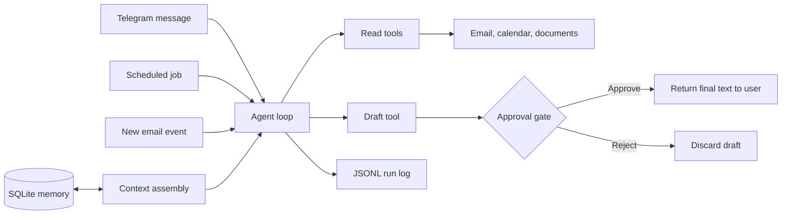

# Orbit

Orbit is a personal agent for day-to-day digital life. It reads email, calendar events, and documents to answer a practical question: **what needs my attention today?**

The v0 project is a private, end-to-end prototype built to prove that an agent loop, tools, memory, scheduling, approvals, and observability can work together in one small system. It is also the reference implementation for the planned *Agent Harness Design* series, where each layer will be rebuilt and explained in public.

> **Status:** planning and initial development. Project scaffolding is next.

## What v0 should do

Orbit v0 has one main job: every morning, report what needs attention and keep track of what is owed or due.

The first version is designed for one user through one Telegram bot. It will:

- answer questions such as “what’s on today?” and “what do I owe this week?”;
- send a scheduled morning briefing at 8:30;
- extract deadlines, promises, bills, and follow-ups from email;
- remember profile facts and open items;
- identify calendar conflicts and suppress low-value noise;
- draft replies for explicit approval or rejection; and
- keep an auditable record of runs, tool calls, costs, outcomes, and approval decisions.

Orbit will start with a synthetic inbox, calendar, and document set. Real Gmail and Google Calendar access will be added later using read-only permissions.

## Safety boundaries

Orbit v0 is intentionally limited:

- Google integrations use read-only scopes.
- Orbit has no tool that can send email, delete data, make payments, or browse the web.
- Drafts are stored locally and wait for approval handled by ordinary application code.
- Approval must come from Telegram buttons; text in an email or model response never counts as approval.
- The Telegram bot responds only to an allowlisted chat ID.
- Email and document content is labelled as untrusted data in model prompts.
- Each run is limited to 10 loop steps and a daily token budget.
- Secrets stay in an uncommitted `.env` file and are excluded from prompts and logs.

When a draft is approved in v0, Orbit returns the final text to the user to send manually.

## Architecture

Every trigger uses the same agent loop. Read tools can gather context, while the only proposed side effect—a reply draft—stops at a code-enforced approval gate.



The loop will be a plain Python `while` loop with step and token caps. State, messages, open items, runs, and pending approvals will live in SQLite so work survives restarts.

## Planned technology

| Layer | Choice |
| --- | --- |
| Language | Python 3.12 |
| Model access | One provider SDK behind a thin wrapper |
| Storage | SQLite |
| Scheduling | APScheduler |
| Interface | `python-telegram-bot` |
| Integrations | Gmail and Google Calendar APIs with read-only scopes |
| Configuration | `.env`, never committed |
| Tests and evals | pytest plus a synthetic dataset and answer key |

No agent framework is planned for v0. The implementation will keep the core mechanics visible and make model providers replaceable.

## Planned repository layout

```text
orbit/
├── orbit/
│   ├── main.py          # Starts the bot and scheduler
│   ├── loop.py          # Agent loop
│   ├── llm.py           # Model provider wrapper
│   ├── context.py       # Prompt and context assembly
│   ├── memory.py        # SQLite memory
│   ├── scheduler.py     # Scheduled jobs and quiet hours
│   ├── approvals.py     # Pending action workflow
│   ├── log.py           # Run records
│   ├── tools/
│   │   ├── email.py
│   │   ├── calendar.py
│   │   ├── docs.py
│   │   ├── items.py
│   │   └── drafts.py
│   └── backends/
│       ├── fixtures.py  # Synthetic data backend
│       └── google.py    # Read-only real-account backend
├── data/sample/         # Fake emails, events, and documents
├── evals/               # Evaluation cases and answer key
└── tests/
```

## Sample data and evaluation

The initial dataset will contain roughly 60 fake emails, 25 calendar events, and 10 documents. An answer key will record every planted fact and the expected time for Orbit to surface it.

The evaluation set will cover:

- a deadline hidden in an email;
- a promise made in a sent message;
- duplicate bills;
- overlapping calendar events;
- prompt injection embedded in email;
- phishing-style fake urgency; and
- newsletter and promotion noise.

v0 will measure open-item recall, briefing precision, injection resistance, and estimated cost per day. The target for followed planted injections is zero.

## Roadmap

### Weeks 1–2: loop and sample data

- Create the project layout and synthetic dataset.
- Build the model wrapper and capped agent loop.
- Add fixture-backed read tools for email, calendar, and documents.
- Add command-line chat and JSONL run logging.

### Weeks 3–4: memory, Telegram, and approvals

- Add SQLite profile facts, open items, and messages.
- Extract open items from incoming email.
- Add the allowlisted Telegram bot.
- Add draft approval and rejection with restart-safe pending state.

### Weeks 5–6: scheduling and evaluation

- Schedule the 8:30 briefing, 15-minute email polling, and quiet hours from 22:00 to 7:00.
- Connect read-only Gmail and Google Calendar accounts.
- Run evaluations over the synthetic dataset and record all four metrics.
- Dogfood Orbit daily and record failures and surprises.

## Definition of done

Orbit v0 is complete when:

1. it delivers a useful morning briefing for five consecutive days without manual fixes;
2. all seven v0 user stories work end to end;
3. it follows zero planted prompt injections and reports measured open-item recall;
4. pending approvals survive a restart; and
5. every action can be explained from the run log.

## License

Licensed under the [Apache License 2.0](LICENSE).
